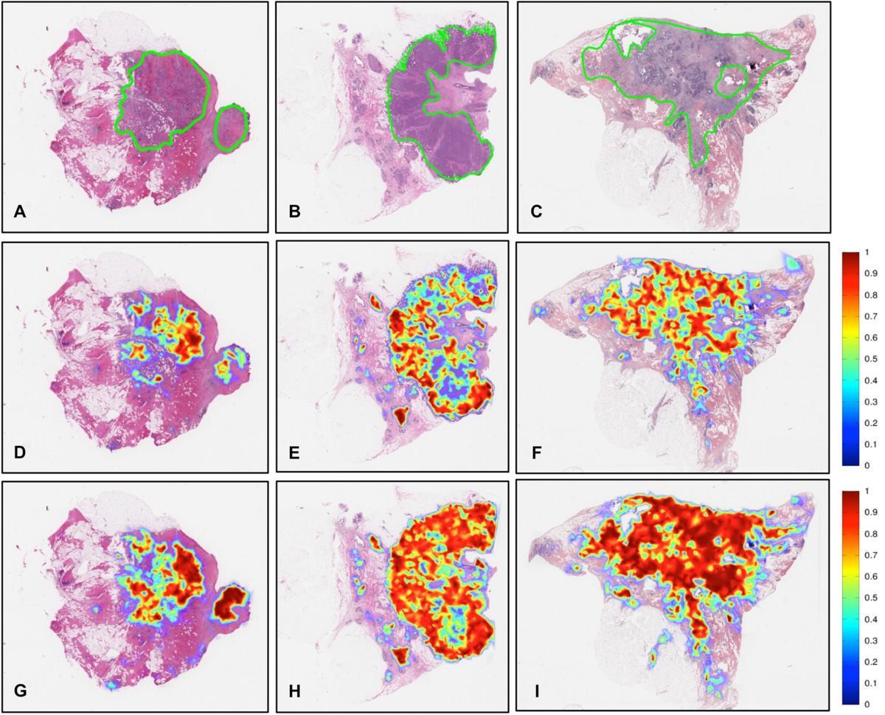

# 🧬 Weakly Supervised Tumor Localization in Whole Slide Images using CLAM

[](https://python.org)
[](https://pytorch.org)
[](https://opencv.org)
[]()
[]()
[](https://qupath.github.io/)
[]()

> **End-to-end Computational Pathology pipeline for weakly supervised tumor classification and localization in Whole Slide Images (WSIs) using CLAM, UNet2 feature extraction, and QuPath visualization.**

---

# 📌 Project Overview

Whole Slide Images (WSIs) are gigapixel pathology images that are too large to process directly with conventional deep learning models.

This project implements a complete **weakly supervised tumor localization pipeline** that processes WSIs into smaller patches, extracts deep features, trains a CLAM model using only slide-level labels, and generates attention-based tumor localization maps for visualization in QuPath.

Instead of manually annotating every tumor region, the model learns which tissue patches are important through **Multiple Instance Learning (MIL)**, significantly reducing annotation effort.

---

# ✨ Key Features

- Weakly Supervised Learning (Slide-level labels only)
- Whole Slide Image (WSI) Processing
- Automatic Tissue Detection
- Patch Extraction Pipeline
- UNet2 Feature Embeddings
- CLAM Multiple Instance Learning
- Attention-based Tumor Localization
- GeoJSON Annotation Generation
- QuPath Visualization
- Production-style Modular Pipeline

---

# 🎯 Problem Statement

Digital pathology slides often exceed **100,000 × 100,000 pixels**, making direct deep learning inference impossible.

The objective of this project is to:

- Detect tumor-positive slides
- Localize suspicious tumor regions
- Reduce manual annotation effort
- Provide interpretable AI predictions
- Integrate with existing pathology workflows

---

# 🏗️ System Architecture

```text
Whole Slide Image (WSI)
          │
          ▼
 Tissue Detection (OpenCV)
          │
          ▼
 Patch Extraction
          │
          ▼
 UNet2 Feature Extraction
          │
          ▼
 1536-D Patch Embeddings
          │
          ▼
 K-Means Validation
          │
          ▼
 CLAM (MIL)
          │
          ▼
 Attention Scores
          │
          ▼
 GeoJSON Generation
          │
          ▼
 QuPath Visualization
```

---

# 🛠️ Tech Stack

| Category | Technology |
|----------|------------|
| Language | Python |
| Deep Learning | PyTorch |
| Image Processing | OpenCV |
| WSI Reading | OpenSlide |
| Feature Extraction | UNet2 |
| Classification | CLAM |
| Learning Method | Multiple Instance Learning |
| Clustering | K-Means |
| Visualization | QuPath |
| Annotation Format | GeoJSON |

---

# 📂 Dataset

This project works on **Whole Slide Images (WSIs)** collected from histopathology tissue samples. Unlike conventional medical images, WSIs are gigapixel images containing extremely detailed tissue structures.

Since these images are too large to process directly, they are divided into thousands of smaller patches before model training.

### Dataset Characteristics

| Property | Description |
|-----------|-------------|
| Image Type | Whole Slide Images (WSIs) |
| Image Size | Up to 100,000 × 100,000 pixels |
| Labels | Slide-level (Tumor / Non-Tumor) |
| Learning Type | Weakly Supervised |
| Annotation | No patch-level labels required |

---

# 🧩 Why Weakly Supervised Learning?

Creating pixel-level annotations for pathology slides is extremely expensive and time-consuming because it requires experienced pathologists.

Instead of manually labeling every tumor region, the model learns from only the slide-level diagnosis.

```text
Traditional Supervision

WSI
 ↓
Thousands of Patches
 ↓
Every Patch Needs Annotation ❌


Weakly Supervised Learning

WSI
 ↓
Slide Label Only ✅
 ↓
Model Learns Important Regions Automatically
```

This significantly reduces annotation effort while maintaining strong classification performance.

---

# 🔄 Project Pipeline

The complete workflow consists of the following stages:

```text
Whole Slide Image
        │
        ▼
Tissue Detection
        │
        ▼
Patch Extraction
        │
        ▼
Feature Extraction (UNet2)
        │
        ▼
Patch Embeddings
        │
        ▼
K-Means Validation
        │
        ▼
CLAM Training
        │
        ▼
Attention Scores
        │
        ▼
Tumor Localization
        │
        ▼
GeoJSON Export
        │
        ▼
QuPath Visualization
```

---

# 🖼️ Step 1 — Tissue Detection

Whole Slide Images contain large white background regions that do not provide useful information.

To reduce unnecessary computation:

- Read WSI using OpenSlide
- Detect tissue regions using OpenCV
- Remove background
- Generate tissue mask

This ensures that only meaningful tissue patches are extracted for further processing.

---

# ✂️ Step 2 — Patch Extraction

Processing an entire gigapixel slide at once is impossible due to GPU memory limitations.

Therefore, each slide is divided into smaller image patches.

### Patch Configuration

| Parameter | Value |
|-----------|------|
| Patch Size | 128 × 128 pixels |
| Alternative Size | 256 × 256 pixels |
| Magnification | 2.5× |
| Background | Removed before extraction |

Each extracted patch is saved together with its original **(x, y)** coordinates so it can later be mapped back onto the WSI.

---

# 🧠 Step 3 — Feature Extraction (UNet2)

Instead of training directly on raw image patches, each patch is converted into a compact feature representation.

The encoder part of **UNet2** is used as a feature extractor.

```text
Patch Image
      │
      ▼
UNet2 Encoder
      │
      ▼
1536-D Feature Vector
```

### Why UNet2?

- Learns rich tissue representations
- Captures multi-scale contextual information
- Reduces computational complexity
- Produces compact embeddings for CLAM

Each patch is finally represented as a **1536-dimensional embedding**.

---

# 📊 Step 4 — K-Means Validation

Before training CLAM, the extracted embeddings are analyzed using **K-Means clustering**.

The objective is not classification, but verifying that the feature vectors capture meaningful tissue characteristics.

This step helps ensure that:

- Similar tissue patches are grouped together
- Tumor and normal tissues become distinguishable
- Feature quality is validated before model training

The generated embedding information is stored in a CSV file, which is later used for CLAM training.

---

# 📄 Generated Training CSV

Each row represents information required for CLAM.

| Column | Description |
|---------|-------------|
| Slide ID | Unique slide identifier |
| Slide Label | Tumor / Non-Tumor |
| Patch Path | Patch image location |
| Embedding Path | Saved feature vector |

This acts as the primary input for Multiple Instance Learning.

---
# 🤖 CLAM (Clustering-constrained Attention Multiple Instance Learning)

The core model used in this project is **CLAM (Clustering-constrained Attention Multiple Instance Learning)**.

Unlike traditional deep learning models that require labels for every image patch, CLAM learns using only **slide-level labels**.

Each Whole Slide Image is treated as a **bag**, while every extracted patch acts as an **instance** inside that bag.


The model automatically learns which patches contribute most toward the final prediction.

---

# 🧠 Multiple Instance Learning (MIL)

In conventional supervised learning:

```text
Image
   │
   ▼
Label
```

Every image requires its own annotation.

In Multiple Instance Learning:



The model determines which patches are important without requiring individual patch annotations.

This makes MIL highly suitable for computational pathology.

---

# 🎯 Attention Mechanism

After extracting patch embeddings, CLAM assigns an **attention score** to every patch.

Higher attention indicates that the model considers that patch more important for determining whether the slide contains tumor tissue.

```text
Patch Embeddings

        │

        ▼

 Attention Network

        │

        ▼

Patch Attention Scores

        │

        ▼

Weighted Slide Representation

        │

        ▼

Tumor / Non-Tumor Prediction
```

Instead of treating every patch equally, the model focuses on the most informative tissue regions.

---

# 📍 Tumor Localization

Once the model predicts a slide as tumor-positive, the generated attention scores are used for localization.

The original coordinates saved during patch extraction allow each attention score to be mapped back onto the Whole Slide Image.

```text
Attention Score

+

Patch Coordinates

↓

Tumor Region
```

This creates an interpretable heatmap showing where the model focused during prediction.

---

# 🌍 GeoJSON Generation

To visualize the detected regions, attention scores are converted into **GeoJSON** annotations.

Each GeoJSON object contains:

- Patch coordinates
- Attention score
- Region boundaries

These annotations preserve the exact spatial location of every high-attention patch on the original slide.

---

# 🔬 QuPath Visualization

The generated GeoJSON files are imported into **QuPath**, an open-source digital pathology platform.

This enables pathologists to view the AI-generated tumor localization directly on the original Whole Slide Image.

```text
Whole Slide Image

        │

GeoJSON Overlay

        │

        ▼

QuPath Viewer

        │

        ▼

Highlighted Tumor Regions
```

Instead of receiving only a classification result, clinicians can visually inspect the regions that influenced the model's decision.

---

# 📈 Model Workflow

```text
Whole Slide Image
        │
        ▼
Tissue Detection
        │
        ▼
Patch Extraction
        │
        ▼
UNet2 Feature Embeddings
        │
        ▼
CLAM (MIL)
        │
        ▼
Attention Scores
        │
        ▼
Slide Classification
        │
        ▼
GeoJSON Generation
        │
        ▼
QuPath Visualization
```

---

# 📊 Performance Summary

| Metric | Value |
|---------|------:|
| Task | Tumor vs Non-Tumor Classification |
| Learning Strategy | Weakly Supervised |
| Core Model | CLAM |
| Feature Extractor | UNet2 |
| Embedding Dimension | 1536 |
| Localization | Attention Maps |
| Visualization | QuPath |
| Classification Accuracy | **95%+** |

---

# ✅ Key Advantages

- No pixel-level annotations required
- Learns directly from slide-level labels
- Scalable to gigapixel Whole Slide Images
- Produces explainable attention maps
- Integrates with existing pathology workflows
- Significantly reduces annotation effort
- Suitable for real-world computational pathology applications

---

# 🚀 Installation

## Prerequisites

- Python 3.10+
- Git
- OpenSlide
- CUDA-enabled GPU (Recommended)
- 8GB+ RAM

---

# ▶️ Running the Pipeline

The complete workflow consists of the following stages:

```text
1. Read Whole Slide Images

↓

2. Generate Tissue Mask

↓

3. Extract Image Patches

↓

4. Generate UNet2 Embeddings

↓

5. Validate Embeddings using K-Means

↓

6. Train CLAM Model

↓

7. Generate Attention Scores

↓

8. Create GeoJSON Files

↓

9. Visualize Results in QuPath
```

# 📊 Results

## Model Performance

| Metric | Value |
|---------|------:|
| Classification Task | Tumor / Non-Tumor |
| Learning Method | Weakly Supervised |
| Accuracy | **95%+** |
| Feature Extractor | UNet2 |
| Core Model | CLAM |
| Localization | Attention-based |
| Visualization | QuPath |

---

## Project Highlights

- Successfully processed gigapixel Whole Slide Images
- Implemented complete weakly supervised learning pipeline
- Generated 1536-dimensional feature embeddings
- Built CLAM-based slide classifier
- Localized tumor regions using attention scores
- Generated GeoJSON annotations for visualization
- Integrated AI predictions with QuPath

---

# ⚡ Challenges

| Challenge | Solution |
|------------|----------|
| Gigapixel WSI size | Patch-based processing |
| Large background regions | Tissue masking using OpenCV |
| No patch annotations | Multiple Instance Learning |
| Feature extraction | UNet2 embeddings |
| Region localization | Attention mechanism |
| Visualization | GeoJSON + QuPath |

---

# 📚 Key Learnings

Throughout this project, I gained practical experience in:

- Whole Slide Image processing
- Digital pathology workflows
- Weakly supervised learning
- Multiple Instance Learning (MIL)
- Attention-based localization
- Feature embedding generation
- CLAM architecture
- Computational pathology
- QuPath integration
- Production-style AI pipeline development

---

# 🔮 Future Improvements

Potential enhancements include:

- Multi-class tumor classification
- Tumor subtype prediction
- Higher magnification analysis
- Faster WSI preprocessing
- Web-based pathology dashboard
- Cloud deployment
- Multi-GPU training
- External clinical validation
- Interactive heatmap visualization

---

# 📖 References

- CLAM: Clustering-constrained Attention Multiple Instance Learning
- OpenSlide
- OpenCV
- PyTorch
- QuPath
- Computational Pathology Research

---


# 📄 License

This project is released under the **MIT License**.

---

# 👩‍💻 Author

**Namrata Patel**

AI/ML Engineer | Computer Vision | Medical Imaging | Computational Pathology

📧 Email: Namratapatel091@gmail.com

🔗 LinkedIn: https://www.linkedin.com/in/namratapatel9027/

💼 Portfolio: https://codebasics.io/portfolio/Namrata-patel

---

<div align="center">

### ⭐ If you found this project helpful, consider giving it a star!

**Built with Python, PyTorch, CLAM, and Computational Pathology ❤️**

</div>
